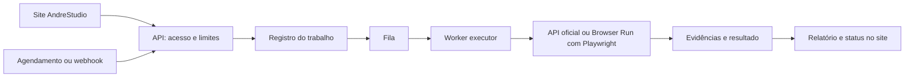

# ROADMAP ESTRATÉGICO — AndreStudio
**Inteligência competitiva, produtos digitais e evolução da plataforma**  
**Pesquisa realizada em 16 de outubro de 2026**

## 1. Direção estratégica e decisões principais

**A recomendação é transformar o AndreStudio em um estúdio com ferramentas e produtos próprios, começando por entregas pequenas que resolvam problemas concretos de produção.**

A primeira oportunidade é ligar três coisas que você já faz: organizar o briefing, planejar o conteúdo e executar o trabalho audiovisual. O cliente pode comprar o material para fazer sozinho, usar uma ferramenta gratuita ou contratar você para implementar.

A sequência comercial será:

**Conteúdo público → ferramenta útil → kit de implementação → serviço → automação recorrente.**

### Decisões adotadas

| Tema | Decisão |
|---|---|
| Público das fases 1 e 3 | Criadores, editores e freelancers digitais. |
| Público das fases 2 e 4 | Profissionais de automação e IA, com serviços de implementação para pequenas empresas. |
| Prioridade financeira | Kits avulsos e serviços nos primeiros 90 dias. |
| Investimento inicial | Nenhuma nova despesa fixa antes de receita recebida. |
| Primeiras vendas | Conversas individuais, WhatsApp, Pix e entrega assistida. |
| Venda automatizada | Checkout externo sem mensalidade, preparado em paralelo. |
| Aquisição | Prospecção inicial e conteúdo orgânico; sem anúncios pagos nesta etapa. |
| Primeira ferramenta | **Brief → Plano de Gravação**, inicialmente executada no navegador. |
| IA e agentes | Ativados depois da validação, com orçamento e limites explícitos. |

Os preços e metas deste documento são **hipóteses de lançamento e critérios internos de decisão**, não previsões de faturamento nem médias comprovadas do mercado.

### Situação real do projeto

O repositório encontrado está em `/Users/andre10/Downloads/andrestudio.dev`. O site usa HTML, CSS e JavaScript, com montagem do pacote público em Python e hospedagem no Cloudflare Pages. A documentação distingue demonstrações de integrações comerciais reais. [README do projeto](/Users/andre10/Downloads/andrestudio.dev/README.md)

Essa base já atende às primeiras etapas. A evolução proposta acrescenta páginas de produtos e ferramentas, preservando serviços, demonstrações, identidade visual e links existentes.

O arquivo futuro poderá se chamar `ROADMAP_ESTRATEGICO.md` nessa raiz. **Neste Modo Planejar, o documento é entregue aqui; nenhum arquivo foi criado ou código alterado.**

## 2. Inteligência competitiva: o que as referências realmente mostram

### Alcance da pesquisa

Foram fornecidas **quatro referências distintas**; o endereço do AiVerso apareceu duas vezes.

As páginas públicas acessíveis foram lidas. O aplicativo Brabo exigiu login, e o endereço específico da aula no Skool redirecionou para a apresentação do grupo. Portanto, a análise distingue:

- **Observado:** páginas, preços, regras e comportamentos públicos.
- **Anunciado:** funcionalidades descritas pelo próprio vendedor.
- **Inferido:** interpretação econômica ou técnica, sem acesso ao funcionamento interno.

Isso permite analisar o produto e o negócio, mas não comprovar o backend, os custos internos ou a qualidade de aulas restritas.

### Comparação das plataformas

| Referência | Oferta e cobrança observadas | Mecânica de valor e retenção | Aplicação ao AndreStudio |
|---|---|---|---|
| **Maestros da IA** | Anuncia trilhas, biblioteca de recursos, aulas e encontros. Assinatura de **R$97/mês**. | Conteúdo publicado disponível desde o início; atualização contínua e comunidade. WhatsApp liberado no segundo mês. Clube de Negócios separado. | Organizar materiais por resultado e caminho de implementação. Evitar assumir encontros frequentes antes de existir capacidade de atendimento. |
| **Brabo Academy / Brabo Space** | Página comercial anuncia cursos, ferramentas, desafios e mentorias. **R$597 à vista ou 12× R$61,74**, com um ano de acesso. Aplicativo público direcionou ao login. | Combina educação audiovisual, recursos e acompanhamento. A utilidade das ferramentas pode incentivar retorno, mas não foi testada internamente. | É a referência mais próxima do público inicial: conectar edição, recursos prontos e produção prática. |
| **AiVerso** | Anuncia três trilhas, templates, skills e ferramentas. **R$397 à vista ou 12× R$41,09**, por um ano, sem renovação automática segundo a FAQ. | Biblioteca, atualizações e ferramentas anunciadas para design e edição. | Empacotar conhecimento e arquivos em uma entrega organizada. Não prometer manutenção ampla por um preço único sem calcular o trabalho futuro. |
| **Skool — AI Automation (A–Z)** | Grupo público de apresentação identificado como privado e gratuito. A aula específica fornecida não ficou acessível. | A apresentação propõe uma jornada curta, recursos e implementação. A oferta paga posterior não ficou comprovada. | Entrada gratuita orientada a uma primeira conquista, seguida de oferta relacionada ao problema resolvido. |

Fontes: [Maestros](https://comunidade.maestrosdaia.com/), [termos Maestros](https://comunidade.maestrosdaia.com/termos), [Brabo Academy](https://braboacademy.com.br/se-torne-um-brabo/), [aplicativo Brabo](https://app.brabospace.com), [AiVerso](https://www.aiverso.tech/), [grupo no Skool](https://www.skool.com/freegroup/about).

**Parcelamento não é recorrência.** Brabo e AiVerso anunciam compras com acesso por período determinado; isso é diferente da assinatura mensal dos Maestros. Receber antecipadamente também cria uma obrigação de entrega durante o período vendido.

### O que existe “por baixo do capô”

| Componente | Natureza econômica | Onde aparece o custo real |
|---|---|---|
| PDF, checklist, prompt, arquivo `.md`, template JSON | Arquivo distribuível, com baixo custo marginal de cópia. | Produção, revisão, compatibilidade, documentação e dúvidas. |
| Aula gravada | Conteúdo reaproveitável. | Produção, hospedagem, atualização e suporte pedagógico. |
| Comunidade e encontros | Serviço contínuo apoiado por software. | Moderação, preparação, atendimento e disponibilidade do fundador. |
| Aplicação com geração por IA | Serviço que executa processamento a cada uso. | Tokens, tentativas, abuso, armazenamento e manutenção. |
| Automação de navegador | Serviço operacional dependente de sistemas externos. | Navegador, autenticação, mudanças de interface e intervenção humana. |

Há evidência concreta de terceirização de infraestrutura nos Maestros: a política de privacidade declara Circle para cursos/comunidade, OnProfit para pagamentos e YouTube para vídeos. Isso mostra que uma oferta percebida como plataforma completa pode combinar serviços existentes. Não comprova toda a arquitetura interna. [Política de privacidade](https://politica.maestrosdaia.com/)

Os termos dos Maestros também esclarecem que determinadas ferramentas, APIs e hospedagens podem gerar despesas adicionais para o aluno. **Biblioteca de agentes não significa, automaticamente, execução de agentes custeada pela comunidade.** [Termos](https://comunidade.maestrosdaia.com/termos)

### Percepção de valor: o que adaptar

Minha interpretação é que essas ofertas aumentam o valor percebido combinando quatro elementos:

1. **Organização:** o comprador encontra um caminho, em vez de pesquisar tudo sozinho.
2. **Aplicação:** exemplos, arquivos e modelos reduzem o trabalho de começar.
3. **Acompanhamento:** atualizações e ajuda reduzem a sensação de abandono.
4. **Identidade:** a pessoa se reconhece como membro de uma profissão ou comunidade.

Para o AndreStudio, a combinação inicial mais sustentável é **organização + aplicação**. Acompanhamento deve ter escopo definido; comunidade permanente pode esperar.

Uma biblioteca com centenas de itens não é necessariamente melhor do que cinco materiais que levam o cliente a terminar um trabalho.

### Retenção, progressão e dependência

O Skool oferece mecanismos de pontos por curtidas, níveis e desbloqueio de cursos, além de liberação por tempo. Esses recursos existem na plataforma; não foi possível confirmar quais são utilizados no grupo analisado. [Pontos e níveis](https://help.skool.com/article/183-how-do-points-and-level-work), [liberação progressiva](https://help.skool.com/article/53-how-to-drip-the-content)

No AndreStudio, a progressão recomendada acompanha entregas:

**Briefing completo → planejamento aprovado → material organizado → vídeo produzido → processo reaproveitado.**

A retenção deve vir de novos projetos, economia de tempo e resultados reutilizáveis. Não há necessidade inicial de pontos, rankings ou bloqueios artificiais.

### Filtro de obsolescência

Não é possível afirmar que uma oferta específica ficará obsoleta em exatamente 90 dias. O risco depende daquilo em que ela se apoia.

| Maior risco de envelhecer rapidamente | Fundamento mais durável | Decisão |
|---|---|---|
| Tutorial baseado apenas na posição dos botões. | Processo de briefing, aprovação e revisão. | Ensinar o processo e separar instruções de interface. |
| “Prompt definitivo” para uma versão de modelo. | Estrutura de entrada, critérios de qualidade e exemplos. | Versionar os prompts e testar resultados. |
| Lista extensa de ferramentas da semana. | Seleção de ferramentas para uma tarefa concreta. | Publicar notícias como aquisição, sem depender delas como produto principal. |
| Agente apresentado como solução universal. | Automação de uma tarefa delimitada e verificável. | Vender um resultado com limites claros. |
| Coleção de JSONs sem documentação. | Fluxo testado, dados de exemplo e diagnóstico de erros. | Reduzir quantidade e aumentar confiabilidade. |
| Acesso “ilimitado” a IA ou suporte. | Franquia mensurável e atendimento delimitado. | Evitar obrigações abertas. |

O diferencial defensável será o conhecimento aplicado do AndreStudio, os exemplos autorais, a distribuição e a qualidade das entregas. **Usar o mesmo modelo de IA ou Playwright disponível para todos não constitui, sozinho, vantagem competitiva.**

## 3. Roadmap nas quatro fases

### FASE 1 — Quick Wins & Ativos de Entrega Imediata
**Esforço baixo; valor prático alto; baixo risco operacional.**

O custo incremental de infraestrutura pode ser próximo de zero usando os recursos existentes. Produção e atendimento continuam consumindo tempo.

#### O que construir exatamente

- [ ] Criar o **Kit Vídeo Pronto para Produzir**, voltado a vídeos promocionais verticais de 30 a 45 segundos.
- [ ] Produzir seis aulas curtas, com duração total aproximada de 45–60 minutos: briefing, objetivo, roteiro, plano de gravação, organização da edição e aprovação.
- [ ] Incluir um briefing editável, modelo de roteiro por cenas, lista de captação, estrutura de pastas e checklist de entrega.
- [ ] Entregar seis prompts autorais acompanhados de entradas, resultados esperados e erros comuns.
- [ ] Incluir um caso completo demonstrando o percurso do pedido inicial à entrega final.
- [ ] Criar uma amostra gratuita que permita experimentar parte do método.

O produto promete **ajudar a preparar e executar um trabalho concreto**. Não promete formar um profissional completo em poucas aulas.

#### Formato e site

Usar PDF, Markdown, planilhas simples e vídeos. Os materiais centrais devem continuar úteis sem uma assinatura específica de IA.

Adicionar:

- `/kits/`: catálogo inicial.
- `/kits/video-pronto/`: página do primeiro produto.
- Na home: entrada para kits, ferramenta gratuita e contratação de serviços.

A página do kit seguirá esta ordem: problema → resultado demonstrado → exemplo → conteúdo → requisitos → preço → compra → dúvidas e limites do atendimento.

Arquivos pagos não entram no pacote público do site. Uma página estática escondida ou um link difícil de adivinhar não é controle de acesso.

#### Preço e atendimento

**Preço piloto: R$97 para os primeiros dez compradores.**  
**Preço regular a testar depois: R$147, pagamento único.**

Incluir os arquivos adquiridos e atendimento assíncrono sobre seu uso por 14 dias. Personalização, edição feita por você e configuração de ferramentas serão serviços separados.

O acesso às aulas ficará disponível por 12 meses. Não anunciar atualizações vitalícias. Correções de defeitos dos materiais não devem ser confundidas com produção ilimitada de novos conteúdos.

#### Venda manual e automática

As primeiras dez vendas terão abordagem por WhatsApp, Pix e entrega assistida, conforme sua escolha. O checkout externo será preparado em paralelo, sem impedir esse lançamento.

**Default: Kiwify**, com Pix/cartão e entrega pela área de membros da própria plataforma. A taxa básica consultada é **8,99% + R$2,49 por venda aprovada**, sem mensalidade; há taxa de saque. [Taxas Kiwify](https://ajuda.kiwify.com.br/pt-br/article/quais-sao-as-taxas-da-plataforma-1ems3wq/)

| Venda à vista | Taxa básica estimada | Saldo antes das demais despesas |
|---|---:|---:|
| R$97 | R$11,21 | R$85,79 |
| R$147 | R$15,71 | R$131,29 |

Configurar uma aula “Comece aqui”, os vídeos e os anexos. Validar os formatos reais dos arquivos antes da divulgação. A plataforma já oferece entrega de acesso e anexos; não é necessário desenvolver uma área de membros própria nesta fase. [Anexos Kiwify](https://ajuda.kiwify.com.br/pt-br/article/como-anexar-arquivos-1ivx4yd/)

Concluir a verificação cadastral cedo: venda aprovada não significa saldo imediatamente disponível para financiar a próxima etapa. [Verificação de identidade](https://ajuda.kiwify.com.br/pt-br/article/verificacao-de-identidade-1xd4l9m/), [liberação de saldo](https://ajuda.kiwify.com.br/pt-br/article/em-quanto-tempo-as-vendas-sao-liberadas-para-saque-152ll49/)

#### Durabilidade e critério de avanço

O valor durável está em reduzir dúvidas, retrabalho e desorganização na produção.

**Avançar após:**

- Dez vendas pagas.
- Pelo menos seis compradores aplicarem o material em um projeto real.
- Suporte mediano de até 20 minutos por comprador.
- Margem de contribuição positiva, incluindo o tempo de atendimento.
- Registro dos principais obstáculos encontrados pelos clientes.

Se houver compra, mas pouca aplicação, corrigir o produto antes de ampliar o catálogo.

---

### FASE 2 — Arsenal Técnico, Templates e Agentes Empacotados
**Esforço médio-baixo; valor associado à implantação confiável.**

A expansão para automação precisa de validação própria: compradores de edição não comprovam demanda de profissionais técnicos.

#### O que construir exatamente

- [ ] Criar o **Kit Operação Criativa Automatizada**.
- [ ] Entregar um pacote de instruções para organizar projetos, com versões apropriadas para `AGENTS.md` e `CLAUDE.md`.
- [ ] Criar duas skills: diagnóstico de briefing e revisão de roteiro/plano de produção.
- [ ] Incluir prompts estruturados para identificação de lacunas e revisão de qualidade.
- [ ] Entregar dois fluxos n8n: transformar uma linha de briefing em documento padronizado; gerar um resumo de pendências a partir de uma planilha de projetos.
- [ ] Manter envio de mensagens externas como etapa revisada pelo operador nos exemplos iniciais.
- [ ] Incluir dados fictícios e um exemplo completo de instalação e execução.

Os arquivos de instruções não serão vendidos como se fossem agentes hospedados. A oferta deve explicar **qual ferramenta interpreta cada arquivo, o que ela precisa para funcionar e quais custos pertencem ao comprador**.

#### Documentação e suporte

Cada recurso terá:

- Objetivo, requisitos e versões testadas.
- Procedimento de instalação e configuração.
- Dados de exemplo e resultado esperado.
- Credenciais necessárias, sempre substituídas por placeholders.
- Erros comuns, recuperação e remoção.
- Limitações, changelog e data da última validação.

A entrega será um pacote versionado, acompanhado de demonstrações curtas. O comprador executa em seu ambiente; implantação personalizada é um serviço adicional.

O n8n possui regras específicas para uso comercial e disponibilização do editor a terceiros. O plano inicial é vender materiais autorais e implantação no ambiente do cliente, sem transformar o AndreStudio em revendedor de uma plataforma n8n hospedada. [Orientação oficial de licenciamento](https://support.n8n.io/article/can-i-use-your-license-for-my-use-case)

#### Preço e durabilidade

**Piloto: R$197. Preço regular a testar: R$297, pagamento único.**

Incluir suporte assíncrono de configuração por 14 dias, limitado aos ambientes documentados. Custos de API, software e hospedagem ficam explicitados antes da compra.

O fundamento durável é a organização de entradas, validação, revisão e entrega. Adaptadores para modelos e serviços externos serão a parte substituível.

#### Critério de avanço

- Validar a oferta com cinco profissionais do público técnico antes de concluir o pacote.
- Conseguir cinco compradores.
- Pelo menos quatro executarem o exemplo com a documentação, sem uma chamada individual.
- Suporte mediano de até 30 minutos por comprador.
- Testar os fluxos em ambiente limpo, sem credenciais do autor.
- Registrar margem positiva após suporte e manutenção.

O desenvolvimento da ferramenta gratuita pode aproveitar os aprendizados da fase 1; não precisa aguardar que a expansão técnica se torne um negócio grande.

---

### FASE 3 — Micro-Apps e “LLMzinho” Integrado na Plataforma
**Esforço médio-alto; implantação em duas etapas dentro da mesma fase.**

#### Primeira entrega: ferramenta gratuita sem API

Construir **Brief → Plano de Gravação**, em `/ferramentas/brief-para-video/`.

**Entradas:** objetivo, público, oferta, duração, formato, materiais disponíveis e restrições.

**Saídas:**

- Resumo organizado do briefing.
- Informações que ainda faltam.
- Até três perguntas essenciais para o cliente.
- Estrutura de cenas com duração, imagem, áudio e texto.
- Checklist de captação.
- Resumo para aprovação.

- [ ] Implementar regras e modelos autorais em JavaScript.
- [ ] Permitir edição do resultado, cópia, download em Markdown e impressão/PDF pelo navegador.
- [ ] Exibir o resultado antes de pedir cadastro.
- [ ] Manter os dados apenas na sessão por padrão.
- [ ] Oferecer, ao final, o kit e a contratação de produção.
- [ ] Informar que a versão inicial organiza o planejamento por modelos; não simular uma análise por IA inexistente.

Isso valida o fluxo e a utilidade sem assumir custo por geração.

#### Segunda entrega: IA financiada pelas vendas

A IA entra para interpretar texto livre, identificar inconsistências e adaptar o planejamento ao contexto.

**Arquitetura:** interface atual → endpoint em Cloudflare Worker → validação e orçamento → API do modelo → resposta estruturada → editor no navegador.

O modelo será chamado pelo servidor. A chave não irá para o HTML, JavaScript público ou `localStorage`.

Interface mínima:

- `POST /api/briefings/gerar`: recebe briefing e identificador da solicitação; retorna o plano estruturado.
- Controle de acesso ao piloto, franquia e registro de consumo no servidor.
- Sem uploads de vídeo, geração de imagens, busca web ou chat com histórico ilimitado na primeira versão.

#### BYOK versus créditos

| Critério | BYOK: chave do usuário | Créditos financiados pelo AndreStudio |
|---|---|---|
| Custo de tokens para o estúdio | Menor. | Precisa de orçamento e controle. |
| Facilidade para criadores | Menor: exige conta, chave e cobrança externa. | Maior: experiência pronta. |
| Atendimento | Dúvidas sobre provedores, saldo e permissões. | Dúvidas concentradas no produto. |
| Responsabilidade técnica | Ainda exige proteção de chaves e tratamento de dados. | Exige impedir abuso e limitar despesas. |
| Adequação inicial | Melhor para produtos técnicos da fase 2. | Melhor para a ferramenta da fase 3. |

**Decisão:** créditos limitados no piloto de IA. BYOK permanece fora da primeira versão pública.

A ferramenta sem IA continua gratuita. O piloto com IA será liberado inicialmente a até 20 compradores convidados, com **cinco gerações por pessoa durante 30 dias**, sem promessa de acesso permanente.

O convite será trocado por uma sessão segura no servidor; não será necessário construir uma plataforma completa de contas.

#### Custos atuais de modelos

Valores consultados em dólares, por um milhão de tokens, para processamento padrão e contexto curto:

| Modelo | Entrada | Saída | Exemplo: 2.000 tokens de entrada + 1.000 de saída |
|---|---:|---:|---:|
| OpenAI GPT-6 Luna | US$0,10 | US$0,50 | US$0,0007 |
| Anthropic Claude Haiku 5.5 | US$0,10 | US$0,50 | US$0,0007 |
| Google Gemini 3.5 Flash-Lite | US$0,30 | US$2,50 | US$0,0031 |
| OpenAI GPT-6.1 Sol | US$2,00 | US$10,00 | US$0,0140 |

Fontes: [OpenAI](https://developers.openai.com/api/docs/pricing), [Anthropic](https://platform.claude.com/docs/en/about-claude/pricing), [Google](https://ai.google.dev/gemini-api/docs/pricing).

Nesse exemplo, mil gerações com Luna custariam US$0,70 apenas em tokens. Com duas chamadas por entrega e uma reserva adicional de 20%, seriam aproximadamente US$1,68. O custo real depende dos tokens faturados, incluindo instruções e processamento adicional.

**Modelo inicial proposto: GPT-6 Luna**, condicionado ao teste de qualidade em português. Se ele não atingir o critério de aceitação, manter a ferramenta determinística enquanto se avalia uma alternativa; não trocar automaticamente para um modelo mais caro em produção.

Assinaturas pessoais já contratadas não serão contabilizadas como crédito de API disponível sem confirmação de elegibilidade. A gratuidade de APIs também não será fundamento do negócio: há diferenças de quotas e tratamento de dados entre modalidades, como documentado pelo Google. [Preços e tratamento de dados](https://ai.google.dev/gemini-api/docs/pricing)

#### Proteção financeira e de dados

- [ ] Reservar receita recebida para dois meses de operação antes de ativar o piloto.
- [ ] Estabelecer teto de **US$20/mês para a API**; infraestrutura é contabilizada separadamente.
- [ ] Limitar entrada, saída e quantidade de chamadas.
- [ ] Reservar atomicamente o custo máximo antes da execução e reconciliar depois.
- [ ] Bloquear novas chamadas quando não houver saldo.
- [ ] Usar identificador de solicitação para evitar cobrança por clique duplicado.
- [ ] Aplicar limites por acesso e proteção adicional contra abuso.
- [ ] Não trocar de modelo nem ativar ferramentas pagas automaticamente.
- [ ] Não registrar briefing completo em logs operacionais.
- [ ] Atualizar a informação de privacidade antes de enviar dados a um provedor.

Cache não entra como economia garantida. Resultados de clientes diferentes não serão compartilhados. O primeiro ganho vem de evitar solicitações duplicadas e prompts desnecessariamente longos.

#### Durabilidade e critério de avanço

O produto resolve um problema estável: transformar um pedido impreciso em algo executável.

**Antes da IA:**

- Testar dez briefings reais.
- Pelo menos oito produzirem um plano aproveitável.
- Medir tempo de correção e aplicação em projeto.

**Antes de ampliar o piloto:**

- Avaliar 30 briefings variados.
- Pelo menos 80% das saídas serem aproveitáveis com até cinco minutos de ajustes.
- Nenhuma falha crítica no conjunto de teste, como inventar condições comerciais ou ignorar restrições.
- Confirmar uso em pelo menos dez projetos reais.
- Comprovar que limites e bloqueio financeiro funcionam sob chamadas simultâneas.

Só considerar assinatura depois de observar uso repetido e disposição concreta a pagar.

---

### FASE 4 — Arquitetura Avançada, Agentes Autônomos e Playwright
**Esforço alto; expansão condicionada a demanda paga e confiabilidade.**

#### Primeiro serviço proposto

O piloto será um **Verificador de Campanhas e Páginas Publicadas**, ligado aos serviços web e de produção do AndreStudio.

Para um domínio autorizado do cliente, o sistema verifica páginas combinadas, links importantes, presença dos elementos esperados e apresentação em desktop/celular. Produz evidências e um relatório de problemas.

A IA organiza e explica as evidências. As verificações objetivas permanecem em código.

Esse recorte permite testar execução agendada e navegação sem começar por um agente genérico que opera qualquer sistema.

#### O que construir exatamente

- [ ] Cadastro interno de cliente, domínio permitido e roteiro de verificação.
- [ ] Execução manual ou semanal agendada.
- [ ] Fila de tarefas e acompanhamento de status.
- [ ] Captura de evidências e relatório.
- [ ] Limites por cliente, duração e concorrência.
- [ ] Reexecução controlada e tratamento de falhas.
- [ ] Revisão humana antes de qualquer futura ação de publicação, envio ou alteração externa.

Priorizar API oficial quando disponível. Usar Playwright para o que depende de renderização ou interação no navegador.

#### Arquitetura escolhida

**Stack:** Cloudflare Pages para o site; Workers para API e execução; Queues para tarefas; D1 para estado; R2 privado para evidências; Browser Run para o navegador.

A opção gerenciada reduz a administração inicial de servidores. A Cloudflare disponibiliza uma versão de Playwright adaptada ao ambiente; a compatibilidade do fluxo precisa ser validada antes da venda. [Playwright no Browser Run](https://developers.cloudflare.com/browser-run/playwright/)

Interfaces mínimas:

- `POST /api/jobs`: cria o trabalho e retorna seu identificador.
- `GET /api/jobs/:id`: informa status e resultado autorizado.
- Estados: aguardando, executando, aguardando usuário, concluído, falhou e cancelado.

A requisição do navegador do cliente não ficará aberta esperando a automação terminar.

#### Regras operacionais

Defaults iniciais: duas execuções simultâneas no sistema, uma por cliente, até três minutos por trabalho e 30 segundos por navegação.

- Validar domínio e redirecionamentos; bloquear destinos internos.
- Isolar contexto de navegador por execução.
- Encerrar navegador ao finalizar ou falhar.
- Tratar páginas externas como dados, nunca como instruções para o agente.
- Guardar evidências privadas por 30 dias e apagar automaticamente.
- Não persistir sessões autenticadas no primeiro piloto.
- Pausar quando houver login, CAPTCHA ou condição não prevista.
- Deduplicar tarefas e tornar reexecuções seguras.

Filas podem entregar uma mensagem mais de uma vez, exigindo deduplicação. [Garantias do Cloudflare Queues](https://developers.cloudflare.com/queues/reference/delivery-guarantees/)

Se uma expansão futura exigir container próprio, ele deverá executar com isolamento apropriado e configuração de sandbox; um contexto separado de navegador não substitui essa proteção. [Orientações Playwright](https://playwright.dev/docs/docker)

#### Custos e monetização

O Workers Paid tem base de **US$5/mês**. O Browser Run inclui dez horas mensais nesse plano e cobra **US$0,09 por hora adicional**, além das regras de concorrência. [Workers](https://developers.cloudflare.com/workers/platform/pricing/), [Browser Run](https://developers.cloudflare.com/browser-run/pricing/)

Exemplo ilustrativo, considerando um minuto de navegador por trabalho e arredondamento das horas:

| Volume | Horas aproximadas | Base Workers + navegador |
|---|---:|---:|
| 1.000 trabalhos/mês | 17 h | US$5,63 |
| 10.000 trabalhos/mês | 167 h | US$19,13 |

Esses valores **não são o custo total do serviço**: faltam IA, armazenamento, demais consumos e trabalho humano.

Se cem execuções exigirem dez intervenções de cinco minutos, serão 50 minutos de atendimento. Esse custo pode superar o navegador.

**Modelo inicial:** setup B2B de **R$1.500**, mais operação de **R$297/mês**, como hipótese comercial para um domínio, um fluxo e até cem execuções mensais. Incluir até 30 minutos de suporte por mês; novos fluxos e alterações de escopo são orçados separadamente.

Validar essa oferta com três potenciais clientes antes da construção. A primeira implementação começa somente com piloto pago e infraestrutura provisionada no orçamento.

SaaS de autosserviço e plano anual ficam para depois de comprovar repetição do mesmo serviço entre clientes. Não vender acesso vitalício a uma operação que gera custo contínuo.

#### Critério de expansão

- Três clientes pagantes para o mesmo fluxo padronizado.
- Pelo menos cem execuções observadas.
- Sucesso técnico de 95% ou mais, com causas das falhas registradas.
- Resultado útil confirmado pelo cliente.
- Suporte dentro da franquia.
- Margem de contribuição de pelo menos 60% após operação e atendimento.

A fase 4 não será acionada apenas porque a tecnologia está disponível.

## 4. Economia do negócio, aquisição e primeiros 90 dias

### Como acompanhar a margem

Usar:

**Margem de contribuição = receita − pagamento − tributos aplicáveis − reembolsos − consumo técnico − trabalho variável de entrega e suporte.**

Exemplo de um kit de R$97 vendido pela Kiwify:

| Item | Valor ilustrativo |
|---|---:|
| Venda | R$97,00 |
| Taxa básica | −R$11,21 |
| 15 minutos de suporte, valorizados a R$60/h | −R$15,00 |
| Saldo parcial | **R$70,79** |

Ainda faltam tributos, saques, reembolsos e recuperação do tempo de produção. O valor de R$60/h é uma premissa interna de cálculo.

Se o atendimento consumir uma hora, o saldo parcial cai para R$25,79. Por isso, documentação e limites de suporte são decisões econômicas centrais.

### CAC e LTV sem números fictícios

Nos primeiros meses, registrar:

- Origem do contato.
- Conversas qualificadas e propostas.
- Vendas e receita efetivamente recebida.
- Horas de aquisição, entrega e suporte.
- Reembolsos e motivo.
- Aplicação do produto e compras posteriores.

O CAC orgânico não é zero: existe tempo investido. Separar desembolso financeiro de custo de trabalho.

Para kits avulsos, avaliar contribuição por comprador e recompra real. Não estimar LTV de assinatura antes de existir uma base com retenção observável.

Sem medição de visitas, não calcular conversão “visitante → comprador”. Começar por conversões com denominador conhecido, como propostas enviadas → vendas.

### Conteúdo e distribuição

Sua estratégia de publicar IA e tecnologia será mantida, com ligação clara ao que o AndreStudio entrega.

Cadência inicial compatível com uma operação solo:

- Três vídeos curtos por semana, reaproveitados entre Reels e Shorts.
- Um post ou carrossel demonstrando processo ou resultado.
- Um artigo técnico a cada duas semanas.
- Uma sessão semanal para revisar perguntas e oportunidades comerciais.

Distribuição editorial proposta:

- **50%:** demonstrações, bastidores e resultados de edição, automação e web.
- **30%:** tutoriais ligados aos kits e à ferramenta gratuita.
- **20%:** tendências de IA e tecnologia, sempre com aplicação prática ao público.

Um tema em alta pode trazer alcance. A conexão com uma tarefa real ajuda a atrair compradores compatíveis com o negócio.

Não publicar automaticamente a mesma mensagem comercial para todos. Nas primeiras conversas, o objetivo é descobrir problema, urgência e disposição a pagar.

### Sequência de execução

Considerando a disponibilidade anteriormente indicada de aproximadamente três horas diárias:

| Período | Prioridade | Evidência esperada |
|---|---|---|
| Dias 1–7 | Conversas com contatos, exemplo completo e definição da oferta. | Problemas recorrentes e interessados concretos. |
| Dias 8–21 | Kit mínimo, página, vendas assistidas e checkout paralelo. | Primeiras vendas e dúvidas reais. |
| Dias 22–30 | Aplicação pelos compradores e revisão dos materiais. | Dez vendas como meta de validação, com margem e suporte medidos. |
| Dias 31–45 | Conteúdo orgânico, aperfeiçoamento do kit e entrevistas do público técnico. | Casos demonstráveis e demanda para a fase 2. |
| Dias 46–60 | Kit técnico mínimo e protótipo local da ferramenta gratuita. | Execução independente e testes com briefings reais. |
| Dias 61–90 | Publicação da ferramenta gratuita e melhoria do funil. | Uso real, oportunidades de serviço e possível piloto de IA financiado. |
| Depois dos critérios de validação | Piloto B2B da fase 4. | Contrato, escopo repetível e operação mensurável. |

Se uma etapa não atingir o critério, o calendário se ajusta. **Os primeiros 90 dias não precisam conter as quatro fases implementadas.**

## 5. Validação, limites e entregáveis de implementação

### Testes de aceite a executar

| Área | Critério |
|---|---|
| Site existente | Serviços, demonstrações, navegação, tema e links continuam funcionando. |
| Publicação | Novas páginas entram na lista explícita do build; materiais privados e segredos ficam fora. |
| Compra automática | Pagamento aprovado libera acesso; pendente não libera; e-mail e downloads funcionam. |
| Materiais | Uma pessoa do público consegue seguir o exemplo sem depender do autor. |
| Ferramenta local | Trata entradas incompletas, permite editar e exportar, funciona no celular e por teclado. |
| IA | Resposta válida, tratamento de indisponibilidade, prevenção de duplicação e bloqueio de orçamento sob concorrência. |
| Isolamento | Um comprador ou cliente não acessa resultado de outro. |
| Agentes | Falha externa encerra recursos, registra causa e não repete efeitos indevidos. |

A implementação deverá executar os testes existentes do projeto e acrescentar verificações específicas para os novos comportamentos críticos.

### Limites de produto

- Produzir exemplos, textos, templates e aulas próprios; usar as plataformas como referência funcional.
- Não incluir materiais adquiridos de cursos em produtos revendidos sem autorização.
- Não anunciar como comprovada uma funcionalidade interna que não foi acessada.
- Não criar uma comunidade com atendimento contínuo antes de medir capacidade.
- Não acrescentar geração de vídeo, imagens, chat genérico e automações arbitrárias ao primeiro micro-app.
- Revalidar preços de fornecedores imediatamente antes da contratação.

Prints e acesso autorizado às plataformas poderão complementar a pesquisa de fluxos. O REA pode apoiar essa observação, mas não transforma uma interface pública em evidência do código ou dos custos internos.

### Resultado esperado desta estratégia

Ao final da primeira etapa de validação, o AndreStudio deverá ter **uma oferta paga clara, entrega manual e automática, exemplos autorais, uma ferramenta gratuita útil e dados reais sobre aplicação, suporte e margem**.

Esses dados determinarão quanto investir em IA e automação. O crescimento da plataforma acompanhará o crescimento comprovado do negócio.
